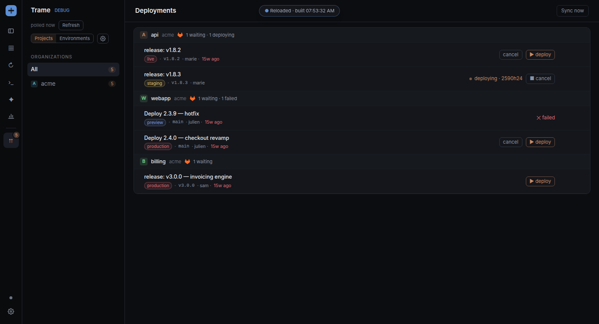

# deployments

A deployments plugin for [Trame](https://github.com/Andarius/trame). It lists the GitHub and GitLab releases **waiting for approval** (plus the ones deploying or recently failed) and approves the gate or plays the manual job from the panel.



## Use

```bash
tramecli plugins add Andarius/trame-plugins/deployments
```

Or, from a clone of this repo next to a Trame checkout:

```bash
just compose deployments   # writes ../trame/plugins.local.json and composes the plugin
(cd ../trame && just dev)
```

Enable it under Settings → Plugins → Deployments, add the GitHub repos and GitLab projects to watch, then authenticate each forge with a PAT, `GITHUB_TOKEN` / `GITLAB_TOKEN`, or the `gh` / `glab` CLI (the login button opens a terminal). Nothing is polled until the plugin is enabled and a repo is watched. Settings from the built-in plugin of Trame ≤ 0.27 carry over (same `deployments` id).

- **Grouping:** by project (the default, each with its logo) or by environment; the sidebar filters by organization or group.
- **Logos:** the project and group avatars are fetched from the forges once a day (GitHub: the owner's avatar; GitLab: the project's and the top-level group's, through `glab` or the token, so private ones work). They stay in memory and are served by the plugin, never written to disk. Without one, a monogram shows.
- **Cards:** a waiting release whose commits reference a card's `pr_url` shows the card on the row and writes one worklog line on it. `tramecli deployments ships` lists or changes the per-repo rule:

  ```
  tramecli deployments ships                    every watched repo's rule
  tramecli deployments ships <repo> [flags]     --env a,b · --pattern '<regex>' · --backport | --no-backport · --reset
  ```

Tokens live only in this machine's `settings.json` (mode 0600). They are never synced to the hub, never sent back to the UI, and the GitLab one is bound to the host it was saved for.

## Test

From the repo root (see its README): `just lint deployments`, then `just compose deployments && just check`.

```bash
just e2e --project deployments   # from the Trame checkout: the e2e/ specs on the fixture backend
```

## Release

Bump `VERSION` in `version.ts` and `src/mod.rs`, merge, then push `deployments-vX.Y.Z` (see the repo README).
