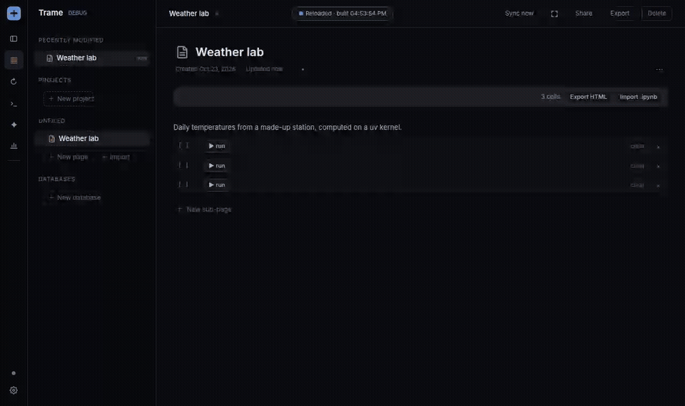

# notebook-cells

A notebook plugin for [Trame](https://github.com/Andarius/trame): pages hold Python code cells that run on a Jupyter kernel.



- **Cells**: a CodeMirror editor, SQL highlighted inside Python strings, an optional import of your PyCharm keymap, and Jupyter command mode (Esc, a/b, dd, j/k, Enter, ⇧⏎, Ctrl+⏎, ii). Outputs are stored in nbformat shapes, so cells convert to and from `.ipynb`.
- **Editor help, PyCharm style**: ruff inspections over all cells read as one notebook (errors and warnings underlined, unused names dimmed), parameters shadowing a notebook name, imports the kernel cannot find, the leading imports folded to `import ...`. From the running kernel: completion, quick doc (Ctrl+Q, F1, hover) and parameter info (Ctrl+P). Reformat (Ctrl+Alt+L) and optimize imports (Ctrl+Alt+O) run ruff. Each cell shows its last run time, measured by the kernel, and a live clock while it runs.
- **Outputs**: pandas tables render as a grid (shape, sortable headers, text left and numbers right, a row filter). Plotly figures draw interactively, themed like the page (plotly.js from jsDelivr). Matplotlib and seaborn figures come out retina, and a `trame` style in the page's colours is opt-in: `plt.style.use("trame")` or `sns.set_theme(style="ticks", rc=plt.style.library["trame"])`.
- **Kernel bar** (sticky): kernel picker, Run all / Stop, Restart, Clear outputs, Variables (the kernel's names, types, shapes, values), Export HTML, Import .ipynb.
- **Project kernels**: a wizard that writes a kernel spec running `uv run --directory <folder> [--python X] --with ipykernel --with …`. It reads the folder's `pyproject.toml`, lists the Pythons uv knows about and fetches package versions from PyPI.

## Use

```bash
tramecli plugins add Andarius/trame-plugins/notebook-cells
```

Or, from a clone of this repo next to a Trame checkout:

```bash
just compose notebook-cells   # writes ../trame/plugins.local.json and composes the plugin
(cd ../trame && just dev)
```

Enable the plugin under Plugins: with no server URL set, it runs its own Jupyter server (`uv tool run --from jupyter-server --with ipykernel`, on a free localhost port with a random token) while it is on, and stops it when Trame exits. To use your own server instead (`jupyter lab --no-browser`), paste its URL and token in the plugin's settings. "/code" in a page adds a cell. While the plugin is off, cells keep showing their source and outputs.

The backend talks to the Jupyter server (REST and kernel WebSockets) and to PyPI when the wizard looks up a package. Inspections, reformat and optimize imports run `ruff` (from PATH, `~/.local/bin`, `~/.cargo/bin`, else `uv tool run ruff`) on the cells' text; completion, docs, variables and the import check ask the running kernel and never start one. Project kernels write kernel specs under `~/.local/share/jupyter/kernels/trame-<name>`, so they need the Jupyter server on the same machine. The PyCharm import reads your IDE's keymap files and never writes them. Cells are page blocks: they sync like the rest of the page.

`src/mod.rs` is the backend, a native Rust module compiled into `trame-local` (it reaches Trame only through `crate::plugins::api`); `web/index.ts` is the frontend (via `@trame/web-api`). CodeMirror and Lezer come from Trame's `app/web/package.json`.

## Test

From the repo root (see its README): `just lint notebook-cells`, then `just compose notebook-cells && just check`.

## Release

Bump `VERSION` in `version.ts` and `src/mod.rs`, merge, then push `notebook-cells-vX.Y.Z` (see the repo README).
